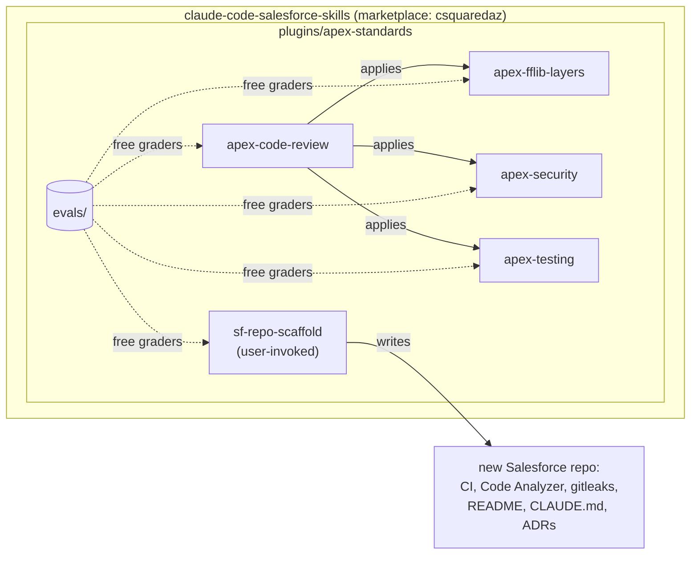

# claude-code-salesforce-skills

[](https://github.com/csquaredaz/claude-code-salesforce-skills/actions/workflows/ci.yml)


## The problem

AI coding assistants write plausible Apex quickly. Plausible isn't the bar. Without written standards, generated code drifts back to old habits: queries in loops, `WITH SECURITY_ENFORCED` instead of user mode, tests that assert nothing, credentials in Custom Metadata. This repo packages one team-grade standard as a Claude Code plugin, so the assistant applies it on every request and the review step checks against the same rules. The design is informed by production experience at scale.

## Architecture



| Skill               | Loads when you…                                       | Produces                                                                                |
| ------------------- | ----------------------------------------------------- | --------------------------------------------------------------------------------------- |
| `apex-fflib-layers` | write or restructure Apex, or ask where logic belongs | A layer plan, then complete classes with governor notes                                 |
| `apex-security`     | touch data access, dynamic SOQL or callouts           | User-mode code, or severity-graded security findings                                    |
| `apex-testing`      | ask for tests or ask whether tests are any good       | A four-line test plan, then a Stub API-isolated test class with bulk and negative cases |
| `apex-code-review`  | ask for a review of a PR, diff or files               | Findings with principle, risk and exact fix, plus a merge verdict                       |
| `sf-repo-scaffold`  | run `/apex-standards:sf-repo-scaffold <name>`         | A Salesforce DX repo wired to the portfolio standards                                   |

## Quick start

```text
/plugin marketplace add csquaredaz/claude-code-salesforce-skills
/plugin install apex-standards@csquaredaz
```

There's nothing to configure: no API keys, MCP servers or paid services.

## Usage

Just ask. The skills load from the request itself:

```text
> Review this before I merge: force-app/orders/classes/OrderFulfilment.cls

## Review summary
Verdict:  Changes requested
Findings: 1 Critical · 2 High · 0 Medium · 1 Low

### [CRITICAL] OrderFulfilment.cls:4, fulfil()
Finding:   SOQL inside the for-loop over orders.
Principle: Selectors own all queries; no SOQL in loops (apex-fflib-layers rule 7).
Risk:      Throws System.LimitException: Too many SOQL queries: 101 when more than 100 orders arrive in one trigger chunk.
Fix:       Query OrderItems once by the full set of Order Ids through the selector, then group by OrderId.
```

Scaffold a new repo explicitly:

```text
> /apex-standards:sf-repo-scaffold order-fulfilment
```

## Design decisions

| Decision                     | Choice                                                                                                     | Rejected alternative                                                               | ADR                                                                                                  |
| ---------------------------- | ---------------------------------------------------------------------------------------------------------- | ---------------------------------------------------------------------------------- | ---------------------------------------------------------------------------------------------------- |
| Layout and naming            | Repo-level marketplace, plugin under `plugins/apex-standards` (names starting with `claude-` are reserved) | Plugin at the repo root; one repo per plugin                                       | [0001](docs/adr/0001-plugin-naming-and-layout.md)                                                    |
| Eval strategy                | Free graders only, run locally, offline structure check in CI                                              | API-keyed eval job in CI; no evals at all                                          | [0002](docs/adr/0002-eval-strategy.md)                                                               |
| Mocking in the testing skill | Platform Stub API with a small recording stub                                                              | Requiring `fflib-apex-mocks` everywhere (adopt it by ADR when matchers are needed) | [stub-api.md](plugins/apex-standards/skills/apex-testing/references/stub-api.md)                     |
| Scaffold invocation          | `disable-model-invocation: true`, because it writes files                                                  | Auto-loading on "set up a repo" requests                                           | [SKILL.md](plugins/apex-standards/skills/sf-repo-scaffold/SKILL.md)                                  |
| CI auth for the scaffold     | External Client App + JWT with the official `SF_SCRATCH_SIGNUP_*` workaround                               | A Connected App, which free Developer Edition orgs can no longer create            | [devhub-jwt-setup.md](plugins/apex-standards/skills/sf-repo-scaffold/references/devhub-jwt-setup.md) |

## Testing

| Layer          | What it proves                                                                                   | Run it                                                                               | Cost                                |
| -------------- | ------------------------------------------------------------------------------------------------ | ------------------------------------------------------------------------------------ | ----------------------------------- |
| Schema         | Marketplace and plugin manifests load, `--strict`                                                | `claude plugin validate --strict plugins/apex-standards`                             | Free (offline)                      |
| Eval structure | Every case loads, only free graders, each skill has positive and negative cases                  | `npm run check:evals`                                                                | Free (offline)                      |
| Lint           | Prettier, markdownlint, template drift guard                                                     | `npm run lint`                                                                       | Free                                |
| Secrets        | gitleaks on full history, plus a custom rule for Custom Metadata XML                             | CI `secrets` job                                                                     | Free                                |
| Behaviour      | Skills trigger on the right prompts, stay out of the wrong ones, and emit the standard's markers | `claude plugin eval plugins/apex-standards --scaffold --allow-tools Bash Write Edit` | Local only, on your own Claude plan |

**Deliberately omitted:** model-judged graders (`llm`, `baseline`) and any CI job that calls a model. Both cost money, and this repo is free by design ([ADR 0002](docs/adr/0002-eval-strategy.md)). CI enforces the omission: `check:evals` fails if a paid grader is added.

## Built with Claude Code

- **Standards:** [`CLAUDE.md`](CLAUDE.md) sets clean-room content, free-only tooling, the skill-authoring limits and the PR workflow. Every AI-assisted commit carries a `Co-Authored-By: Claude` trailer.
- **Concrete example 1: a secret-scanning gap.** While auditing an old repo of my own before starting this portfolio, Claude Code ran gitleaks across its full history and also grepped it manually. The grep found an API key stored as a Custom Metadata _value_, which gitleaks' default rules missed because the value sits on a different line from the field name. Claude drafted the `salesforce-custom-metadata-secret` rule in [`.gitleaks.toml`](.gitleaks.toml). I had it proved three ways before accepting it: a positive fixture, a negative fixture with `xsi:nil` and short values, and a re-scan of that old history, which went from 17 findings to 20 by catching exactly the three metadata secrets the defaults missed. The rule now ships in every scaffolded repo, with a CI drift guard.
- **Concrete example 2: a template smoke test.** Before the scaffold templates were committed, Claude Code copied them into a scratch repo, filled the placeholders and ran every gate. That caught three defects that would have broken the first real repo: trailing commas against the template's own Prettier config, ESLint failing on a repo with no LWC yet, and Code Analyzer's Flow engine failing on a machine without Python 3.10. All three were fixed in [`feat(scaffold)` commits](https://github.com/csquaredaz/claude-code-salesforce-skills/commits/main) whose messages record the verification.
- **How it was reviewed:** each PR has CI (lint, schema, eval structure, secrets), and every change goes through the `apex-code-review` standard where it applies.

## License

MIT
